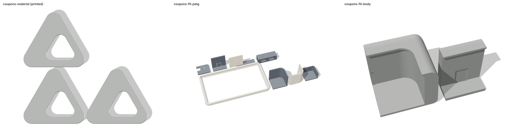

# Coupon results (Paul fills this in)

**Status: Print 1 (material slices) is done and applied. Prints 2–3 (fit coupons) and the measurements are still to come.**

Print the coupons, try them, tick or write an answer in each box. Each answer names the
`cad/params.py` value it changes, so the full model can be updated in one pass.
Bring the **"Measure these"** numbers back at the same time.

Files are in `hardware/enclosure/coupons/` (picture: `coupons/coupons.png`).

## What to print

The 3MF files carry shapes and names only. Set the walls and infill per object in Bambu Studio
(right-click the object → per-object settings). Everything is already lying in its print orientation.

| File | Object | Material | Walls | Infill | Notes |
|---|---|---|---|---|---|
| `coupons-material.3mf` (done) | **T1** | TPU for AMS | 2 | 10 % gyroid | softest: **chosen** |
| | **T2** | TPU for AMS | 3 | 20 % gyroid | middle |
| | **T3** | TPU for AMS | 5 | 35 % gyroid | firmest |
| `coupons-fit-petg.3mf` | **GLASS-ring** | PETG (cream if you have it) | 4 | 15 % | prints face down |
| | **SEAT-bezel**, **CLIP-bezel** | PETG | 4 | 15 % | print face down |
| | **SEAT-frame**, **CLIP-frame** | PETG | 4 | 15 % | |
| | **SEAT-plate**, **SEAT-cover** | PETG | 4 | 15 % | |
| | **MIC-plate**, **PORT-block** | PETG | 4 | 15 % | |
| `coupons-fit-body.3mf` | **SEAT-body**, **CLIP-body** | TPU for AMS | 2 | 10 % gyroid (T1) | supports off |

The material slices are the real triangle outline, 15 mm thick, name sunk into the top.
All layer heights 0.2 mm for the coupons, except GLASS-ring and the bezel pieces at 0.12 mm.

## 1. Material slices: DONE (Print 1, 2026-11-13)

| Question | Paul's answer | Applied |
|---|---|---|
| Body material | **TPU for AMS.** Not stone PLA, and no other TPUs (no external spools) | `FRAME_FIT` stays 0.00; stone PLA slice P1 and the PLA fallback removed |
| Feel on the outside | **T1** (2 walls, 10 % gyroid) | `SOFT_ZONE = "T1"` |
| Stiff enough at the screen wall | **T1 was stiff enough** | `FIRM_ZONE = None`; firm modifier only if the SEAT coupon shows the pocket flexing |
| Stays put when tapped | **yes** | no change (`PAD_D`, `LEG_T`, `BACK_ANGLE`) |
| Layer lines on the outside | **OK** | print orientation stays: standing on the portrait end |
| Back leg 13 mm | **right** | `LEG_T = 13.0` confirmed |
| Extra | **No sharp edges anywhere**; bed edges 45° chamfer blended into a round; elephant-foot compensation on; seams on an inside edge; finer layers on the curved edges | `ROUND_ALL` (preview, waiting for Paul's OK on `out/q-round.png`), `BED_CHAMFER`, `BODY_PRINT` |

## 2. GLASS-ring (the front 6 mm of the bezel, all the way round)

Lay the screen module in it, glass down. Never press on the glass.

| Question | Answer | Changes |
|---|---|---|
| Glass drops in? | ☐ falls in, rattles ☐ just right ☐ tight ☐ won't go | rattles → `GLASS_CLEAR` −0.10; tight → +0.10; won't go → +0.20 |
| Lip covers only the black border, not the picture? | ☐ yes ☐ covers picture on: ____ side | `LIP_OVERLAP` |
| Black border looks even enough behind the cream? | ☐ yes ☐ no | no → bezel width question again (`BEZEL_WALL`) |
| Gap between lip and glass when the board rests on the bench | ☐ none (touching) ☐ small ☐ large | `LIP_GAP`, and the "module depth" measurement below |

## 3. SEAT (one corner: body + frame + bezel + plate + cover)

Push SEAT-frame into SEAT-body. Then SEAT-bezel into the frame. SEAT-plate sits on the step inside
the bezel, SEAT-cover snaps in behind it.

| Question | Answer | Changes |
|---|---|---|
| Frame into body | ☐ loose ☐ right ☐ too hard ☐ won't go under the lip | loose → `FRAME_FIT` −0.10; too hard → +0.10; won't go → `FRAME_TOP` or split the body |
| Does the T1 body wall bulge or flex where the frame sits? | ☐ no ☐ a little ☐ yes | yes → `FIRM_ZONE = "T2"` (firm modifier around the pocket only) |
| Bezel into frame | ☐ loose ☐ right ☐ tight | loose → `FRAME_CLEAR` −0.05; tight → +0.10 |
| Seam between cream and body: even? width? | ☐ good ☐ too wide ☐ too tight / rubbing | `SEAM` (now 0.30) |
| Bezel face flush with the body face? | ☐ flush ☐ proud by ___ ☐ sunk by ___ | `FRAME_FLOOR` / `POCKET_D` (tell Claude the number) |
| Plate on its step | ☐ loose ☐ right ☐ tight | `PLATE_CLEAR` (now 0.20) |
| Cover snap | ☐ falls out ☐ right ☐ too hard to open | falls out → `SNAP_BUMP` +0.10; too hard → −0.10; sloppy → `COVER_CLEAR` −0.05 |

## 4. CLIP (a straight piece with one spring clip)

Push CLIP-frame into CLIP-body, then slide CLIP-bezel in until it clicks. Pull it out ten times.

| Question | Answer | Changes |
|---|---|---|
| Click and hold | ☐ no click ☐ weak ☐ right ☐ too stiff | none/weak → `CLIP_BUMP` +0.15; too stiff → `CLIP_BUMP` −0.15 or `CLIP_LEN` +3 |
| Finger survived ten pulls? | ☐ yes ☐ whitened ☐ snapped | whitened/snapped → `CLIP_LEN` +4 and `CLIP_BUMP` −0.10. Second failure → drop clips, use magnets (brief: one iteration only) |
| Finger printed free (slots open)? | ☐ yes ☐ fused | fused → `CLIP_SLOT` +0.2 |

## 5. MIC-plate (three holes: 1.8, 2.0, 2.2)

| Question | Answer | Changes |
|---|---|---|
| Which is the smallest hole that printed clean and round? | ☐ 1.8 ☐ 2.0 ☐ 2.2 | `MIC_HOLE_D` (keep 2.0 if clean: that is the LyricFlash hole) |

## 6. PORT-block (two plug tunnels: "+0" as modelled, "+1" a millimetre bigger)

Hold it against the board's USB end and push your usual cables through to the ports.

| Question | Answer | Changes |
|---|---|---|
| Thickest cable you use: which tunnel does the plug pass and seat fully? | ☐ +0 ☐ +1 ☐ neither (plug is ___ × ___) | `USB_WINDOW` |
| Do both tunnels line up with both ports at once? | ☐ yes ☐ off by ___ | `USB_Y` (would mean the drawing is off; tell Claude) |

---

## Measure these (most important first)

Calipers in mm, one decimal. Don't squeeze the battery.

| # | What | Where to put the calipers | Updates |
|---|---|---|---|
| 1 | **Battery thickness** | Flat on the bench, jaws across the thickest point, including the taped protection board. Just touching, no pressure | `BATT_T` (sets the front-wall thickness) |
| 2 | **Battery length and width** | Outer edges of the pouch including the folded seam and the protection board end | `BATT_L`, `BATT_W` (bay is 106 × 70.4 now) |
| 3 | **Module depth** | Screen face down on a soft cloth. Depth rod from the bench (= glass front) to the top of the 40-pin header | `MODULE_DEPTH` (STEP says 12.8, drawing says 11.6) |
| 4 | **Glass front to standoff top** | Same set-up, depth rod to the top of one of the four brass standoffs | checks `GLASS_TO_BOARD` + `STANDOFF_H` (should be 11.6). This sets the lip gap over the glass |
| 5 | **Battery wires** | Which edge they leave from (short end or long side), and length from pouch to plug | battery orientation, `WIRE_NOTCH` |
| 6 | **Accelerometer board** | Length × width; height including the tallest part and any pins; hole diameter; hole centre spacing | `ACC_L`, `ACC_W`, `ACC_T` |
| 7 | **Glass outline** | Across the glass, long side and short side | checks `GLASS_L`, `GLASS_W` (126.9 × 70.7) |
| 8 | **USB-C plug overmould** of the cable you'll leave plugged in | Width and thickness of the plastic grip behind the metal tip | `USB_WINDOW` (now 12.5 × 7.0) |
| 9 | **Speaker**, if you want it fitted | Diameter and total depth | not modelled yet; needs a home (see decisions) |

Read off the board's printed labels (no calipers):

| # | What | Updates |
|---|---|---|
| 10 | Order of POWER / BOOT / RESET, starting from the USB end | button access (all three are paperclip holes now) |
| 11 | Which USB-C port is "UART" (upper or lower when the buttons are on top) | cable guidance only |
| 12 | Which 2-pin socket is BAT and which is SPK | `WIRE_NOTCH` position |
| 13 | Do the mics have a hole on **top** of their metal can (facing away from the board)? | confirms the mic path out of the back |
