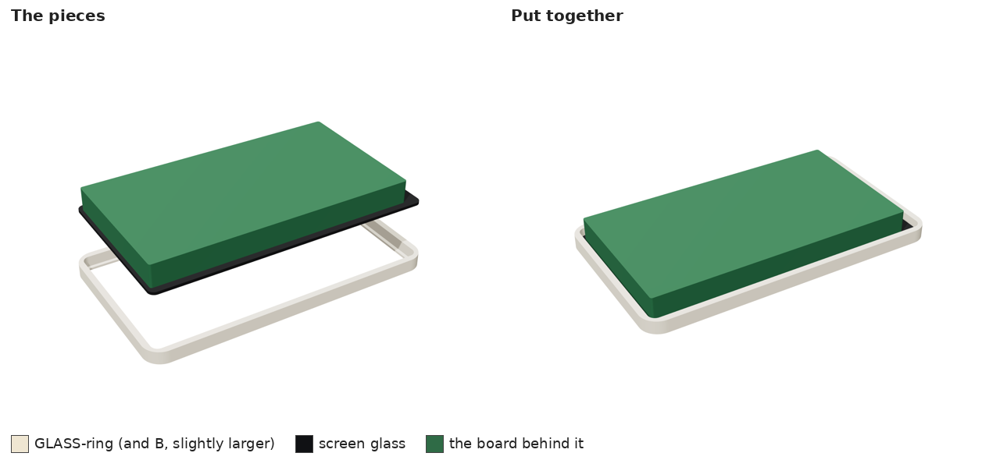
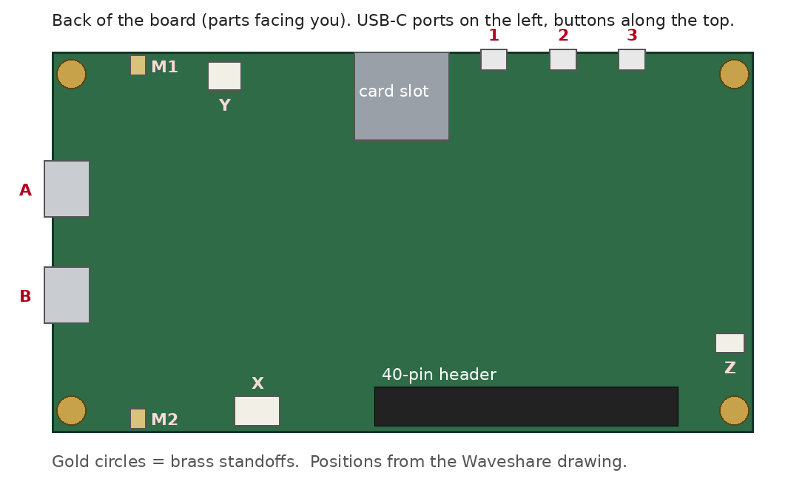
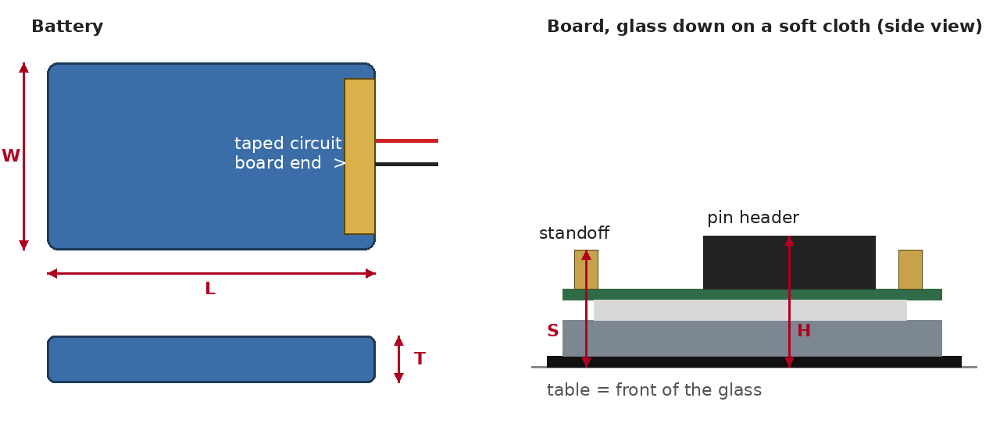

# Remaining tests

**Left to do: A. Reprints: 2 · B. Tests not done yet: 0 · C. Needs the board: 1 · D. Measurements: 5**

Only what is still open. Finished tests are not here (the record of those is COUPON-RESULTS.md). Tick a box or write in a blank. Never press on the screen glass.

## Print settings (use these for every remaining piece)

| Piece | Settings |
|---|---|
| Every PETG piece | 0.4 mm nozzle. 0.2 mm layers. Line width 0.42 mm for every line type (outer wall, inner wall, top/bottom, infill, first layer). Wall generator Classic. 4 walls, 5 top and 5 bottom layers, 15 % gyroid. Supports off, brim off. Elephant foot compensation 0.15 mm. |
| GLASS-ring, GLASS-ring-B, BTN-cup | As above, but 0.12 mm layers. Face down (already laid that way in the 3MF). |
| BTN-pin-1, -2, -3 | As above, but 0.12 mm layers, 3 walls, 100 % infill (they are only 2.6 mm thick). They stand on their heads. |
| Every TPU for AMS piece (BTN-body) | TPU for AMS profile speeds. 0.2 mm layers. Line width 0.42 mm. 2 walls, 10 % gyroid. Supports off. Elephant foot compensation 0.15 mm. Filament dried. |
| Where the settings are | Bambu Studio: Process, tab Quality, 'Line width'; tab Strength, 'Wall generator'. Set both before slicing. Classic keeps every wall exactly 0.42 mm; the other generator (Arachne) squeezes wall widths to fit thin features, which changes how a lip or a pocket comes out. |

## A. Reprints (pieces changed by your last results)

Two things to print: the PETG plate (coupons/petg-plate.3mf: the two glass rings and the PETG button pieces), and the TPU button strip that is printing now. Cap, clip, seat and back-cover tests are finished.

### A4. Button pins on the bench (new)

**What you're testing and why:** Paul's note: the newest board needs a hard press of its POWER button to switch back on, so every button (POWER, BOOT, RESET) now has a pusher pin that reaches from the button, through the module wall, the frame and the soft body, to a small dimple on the top ridge. This strip is the real case around the three buttons, so you can check the fit and the feel. A picture of the whole path is renders/peak-button-path.png.

| Piece | Where it is | Note |
|---|---|---|
| **BTN-body** | coupons/coupons-buttons.3mf (or BTN-body.stl) | TPU: printing now. Prints standing up |
| **BTN-frame** | coupons/petg-plate.3mf (or BTN-frame.stl) | PETG |
| **BTN-cup** | coupons/petg-plate.3mf (or BTN-cup.stl) | PETG, front face down, 0.12 mm layers |
| **BTN-pin-1, -2, -3** | coupons/petg-plate.3mf (or BTN-pin-N.stl) | PETG, standing on their heads; walls 3, infill 100 % |

**Print settings:** Per-piece settings are in the table at the top. These pieces keep the version you already have; they match the TPU strip that is printing.

**What to do:**

1. Stack the strip in this order: BTN-cup (flat side towards the body), then BTN-frame, then BTN-body with its curved ridge at the far end. Line up the three pairs of holes.
2. Push a pin in from the ridge end, head last, until it is through all three layers. Do the same for the other two.
3. Press each pin with a fingertip, then with a pen tip. Let go and see where it ends up.
4. Hold the strip with the ridge pointing down and shake gently, then lay it on its side with the ridge to the left.
5. Pull a pin out again with a fingernail.

| Question | Answer |
|---|---|
| Do the pins slide through all three layers? | ☐ freely  ☐ stiff but go  ☐ stick  ☐ won't go through |
| Does a pin move freely under a fingertip (no sticking, no scraping)? | ☐ yes  ☐ a little stiff  ☐ sticks |
| Is the head easy to find and press with a fingertip? | ☐ yes  ☐ too small  ☐ too sunk in  ☐ too proud |
| When you tip it with the ridge down, do the pins fall out? | ☐ no  ☐ one does  ☐ all do |
| Can you pull a pin out again with a fingernail? | ☐ yes, easily  ☐ yes, but hard  ☐ no |
| Did the three pin holes in BTN-body print clean (round, not blocked)? | ☐ yes  ☐ no |

### A5. Glass ring, second try

**What you're testing and why:** The first ring did not fit the real screen, and you saw white adhesive on the inside of the glass edge. This time there are two rings: A is as designed (0.3 mm of room per side), B has 0.25 mm more room per side. Print them with the settings in the table at the top: last time the line width was probably different, which changes how thick the walls come out and how big the pocket is. If one fits, we know how much room the glass needs; if neither does, we need the adhesive measurement (D10).

| Piece | Where it is | Note |
|---|---|---|
| **GLASS-ring** | coupons/petg-plate.3mf (or GLASS-ring.stl) | PETG, 0.12 mm layers, face down. Same file as before: reprint it with the correct line width |
| **GLASS-ring-B** | coupons/petg-plate.3mf (or GLASS-ring-B.stl) | PETG, 0.12 mm layers, face down. New: bigger pocket |

**Print settings:** PETG (cream if you have it), 4 walls, 15 % gyroid, 0.12 mm layers, line width 0.42 (all types), Classic walls, supports off. Elephant foot compensation 0.15 mm. Prints face down.

**What to do:**

1. First measure the screen module with the white adhesive on it (test D10).
2. Lay a ring face down on a soft cloth. Lower the screen into it, glass down. Never press on the glass.
3. Do the same with the other ring.
4. Turn the one that fits over and look at the screen through the opening, switched on if you can.

| Question | Answer |
|---|---|
| Which ring does the screen drop into? | ☐ A only  ☐ B only  ☐ both  ☐ neither |
| In the ring that fits, how much play is there? | ☐ rattles  ☐ just right  ☐ tight |
| Is the white adhesive visible or catching on the ring's wall? | ☐ no  ☐ yes, on the ___ side(s) |
| Does the lip cover only the black border, not the picture? | ☐ yes  ☐ covers the picture on the ___ side |
| Does the black border look even enough behind the cream? | ☐ yes  ☐ no |
| With the board resting in the ring, is there a gap between lip and glass? | ☐ touching  ☐ small gap  ☐ large gap |

## B. Tests not done yet

Nothing left here. The seat test is finished, and the T1/T2/T3 material test was answered long ago (TPU for AMS, T1, no firm zone, 13 mm legs right).

## C. Needs the board (when it arrives)

Needs the printed button pieces from A4 and the real board. The plate, ports and labels are done.

### C5. Buttons on the real board

**What you're testing and why:** The point of the whole pin design: every button must be pressable with the case shut. This checks the pins really reach the real buttons, that they click, and that you can switch the board back on with a hard POWER press. The newest board may differ from Waveshare's drawing, so this is the first test that uses real hardware.

| Piece | Where it is | Note |
|---|---|---|
| **BTN-cup, BTN-pin-1, -2, -3** | from test A4 | reuse them |

**Print settings:** Nothing to print.

**What to do:**

1. Lay the board on the table with the three buttons along the top edge, as in the picture. From the USB-C end: 1 = RESET, 2 = BOOT, 3 = POWER.
2. Hold BTN-cup so its flat inner face is 3 mm from the board's top edge (use a 3 mm spacer), with the three holes centred over the three buttons.
3. Push each pin through the hole until it touches its button. Press, and feel for the click.
4. Switch the board off, then use the pin over POWER to switch it back on.

| Question | Answer |
|---|---|
| Do the three holes sit over the three buttons? | ☐ yes  ☐ off by ___ mm sideways  ☐ off by ___ mm up or down |
| How far did you have to slide BTN-cup sideways to centre the holes (the strip is printed at the old drawing positions; the real buttons are about 1.9 mm further from the USB-C end)? | ☐ not at all  ☐ ___ mm towards the USB-C end  ☐ ___ mm away from the USB-C end |
| Does each pin click its button? | ☐ all three  ☐ only ___  ☐ none |
| Does the pin leave the button properly when you let go (no stuck press)? | ☐ yes  ☐ no |
| Can you switch the board back on by pressing POWER through its pin? | ☐ yes, short press  ☐ yes, needs a hard press  ☐ no |
| How hard do you have to press (BOOT or RESET)? | ☐ light  ☐ firm  ☐ very hard |

## D. Measurements (calipers)

Calipers, in mm, one decimal. D1, D2 and D5 need the battery, D6 the accelerometer, D10 the screen you already have.

### D1. Battery thickness

**What you're testing and why:** The most important number. It sets how thick the front wall of the case is.

**What to do:**

1. Lay the battery flat. Close the jaws across the thickest point, including the taped circuit board at the end. Just touching: do not squeeze.

| Question | Answer |
|---|---|
| Thickness (T) | ☐ ___ mm |

### D2. Battery length and width

**What you're testing and why:** Checks the battery fits its bay (106 x 70 mm now).

**What to do:**

1. Measure the outer edges of the pouch, including the folded seam and the circuit-board end.

| Question | Answer |
|---|---|
| Length (L) | ☐ ___ mm |
| Width (W) | ☐ ___ mm |

### D5. Battery wires

**What you're testing and why:** Decides which way round the battery goes and where its wires pass.

**What to do:**

1. Note which edge the wires leave from. Measure from the pouch to the plug.

| Question | Answer |
|---|---|
| Wires leave from | ☐ a short end  ☐ a long side |
| Wire length | ☐ ___ mm |

### D6. Accelerometer board

**What you're testing and why:** So its seat can be made the right size; it has to sit rigid and square.

**What to do:**

1. Measure the little board: length, width, total height including the tallest part and any pins, hole size, and the spacing between hole centres.

| Question | Answer |
|---|---|
| Length x width | ☐ ___ x ___ mm |
| Height | ☐ ___ mm |
| Hole size and spacing | ☐ hole ___ mm  ☐ spacing ___ mm |

### D10. The screen with its white adhesive

**What you're testing and why:** The first glass ring did not fit and you noticed white adhesive on the inside of the glass edge (top, right and bottom). If it sticks out past the glass edge, the pocket has to be bigger.

**What to do:**

1. With the screen glass up, measure the whole outline at the widest point, including any white adhesive: long side, then short side.
2. Then note how far the adhesive sticks out past the glass edge on each side, and how thick it is.

| Question | Answer |
|---|---|
| Outline with the adhesive: long side x short side | ☐ ___ x ___ mm |
| Adhesive sticks out past the glass by | ☐ top ___ mm  ☐ right ___ mm  ☐ bottom ___ mm  ☐ left ___ mm |
| Adhesive thickness | ☐ ___ mm |

---

For Claude: what each answer changes (ignore this)

| Test | Answer | Changes in cad/params.py |
|---|---|---|
| A5 | rings | `A fits: GLASS_CLEAR stays; B only: GLASS_CLEAR +0.25 (and the real bezel pocket); neither: from D10; lip/border/gap: LIP_OVERLAP, BEZEL_WALL, LIP_GAP` |
| D10 | adhesive | `GLASS_CLEAR (pocket must clear glass + adhesive); maybe a relief groove` |
| A4 | pins | `stick/stiff -> TUNNEL_D +0.1 or PIN_D -0.1; too small/sunk/proud -> PIN_HEAD_D, PIN_PROUD, CBORE_D; fall out -> add a retaining lip in the dimple; hard to pull -> PIN_PROUD +0.4` |
| A4 | holes clean | `no -> TUNNEL_D +0.2 (teardrop in the TPU body)` |
| C5 | reach / click | `off sideways -> BUTTONS_X; up or down -> BUTTON_H; no click -> pin tip (BTN_TIP_Y) or BUTTON_HOLE_D; stuck press -> TUNNEL_D, PIN_D` |
| C5 | hard press | `only if POWER needs more travel: PIN_OVERTRAVEL` |
| D1 | T | `BATT_T (drives FRONT_T)` |
| D2 | L, W | `BATT_L, BATT_W` |
| D5 | wires | `battery orientation, WIRE_NOTCH` |
| D6 | accelerometer | `ACC_L, ACC_W, ACC_T, seat on the plate` |

