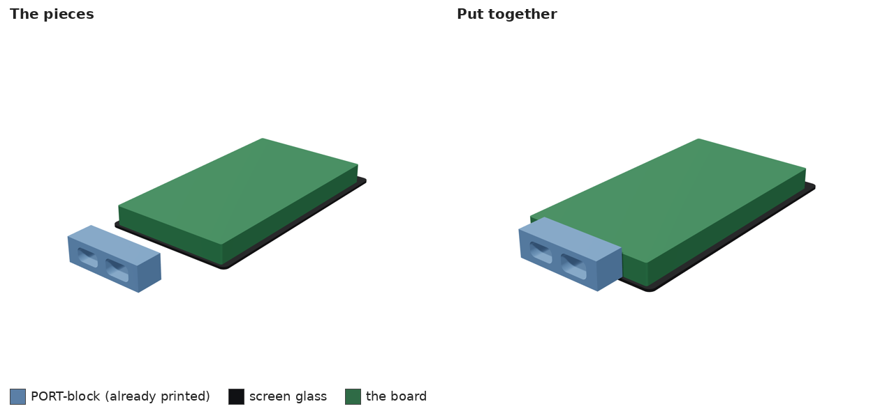
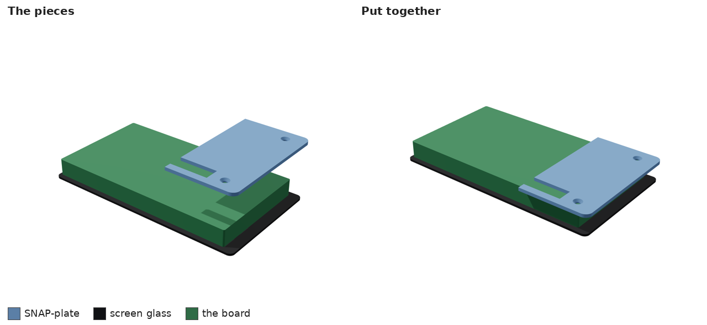

# Remaining tests

**Left to do: A. Reprints: 1 · B. Tests not done yet: 0 · C. Needs the board: 5 · D. Measurements: 9**

Only what is still open. Finished tests are not here (the record of those is COUPON-RESULTS.md). Tick a box or write in a blank. Never press on the screen glass.

## A. Reprints (pieces changed by your last results)

One new thing to print: the button strip (coupons/coupons-buttons.3mf). The cap, clip, seat and back-cover tests are all finished.

### A4. Button pins on the bench (new)

**What you're testing and why:** Paul's note: the newest board needs a hard press of its POWER button to switch back on, so every button (POWER, BOOT, RESET) now has a pusher pin that reaches from the button, through the module wall, the frame and the soft body, to a small dimple on the top ridge. This strip is the real case around the three buttons, so you can check the fit and the feel before the board arrives. A picture of the whole path is renders/peak-button-path.png.

| Piece | Where it is | Note |
|---|---|---|
| **BTN-body** | coupons/coupons-buttons.3mf (or BTN-body.stl) | TPU for AMS, T1 settings. Prints standing up; supports off |
| **BTN-frame** | coupons/coupons-buttons.3mf | PETG |
| **BTN-cup** | coupons/coupons-buttons.3mf | PETG, front face down |
| **BTN-pin-1, -2, -3** | coupons/coupons-buttons.3mf | PETG, standing on their heads |

**Print settings:** PETG, 4 walls, 15 % infill, 0.2 mm layers, supports off for the PETG pieces; TPU for AMS, 2 walls, 10 % gyroid, 0.2 mm layers, supports off for BTN-body.

**What to do:**

1. Stack the strip in this order: BTN-cup (flat side towards the body), then BTN-frame, then BTN-body with its curved ridge at the far end. Line up the three pairs of holes.
2. Push a pin in from the ridge end, head last, until it is through all three layers. Do the same for the other two.
3. Press each pin with a fingertip, then with a pen tip. Let go and see where it ends up.
4. Hold the strip with the ridge pointing down and shake gently, then lay it on its side with the ridge to the left.
5. Pull a pin out again with a fingernail.

| Question | Answer |
|---|---|
| Do the pins slide through all three layers? | ☐ freely  ☐ stiff but go  ☐ stick  ☐ won't go through |
| Does a pin move freely under a fingertip (no sticking, no scraping)? | ☐ yes  ☐ a little stiff  ☐ sticks |
| Is the head easy to find and press with a fingertip? | ☐ yes  ☐ too small  ☐ too sunk in  ☐ too proud |
| When you tip it with the ridge down, do the pins fall out? | ☐ no  ☐ one does  ☐ all do |
| Can you pull a pin out again with a fingernail? | ☐ yes, easily  ☐ yes, but hard  ☐ no |
| Did the three pin holes in BTN-body print clean (round, not blocked)? | ☐ yes  ☐ no |

## B. Tests not done yet

Nothing left here. The seat test is finished, and the T1/T2/T3 material test was answered long ago (TPU for AMS, T1, no firm zone, 13 mm legs right).

## C. Needs the board (when it arrives)

C1 to C3 and C5 use printed pieces on the real board (C3 uses the SNAP-plate you already printed). C4 is reading labels. Newest Waveshare boards may differ from the drawing, so C4 and C5 matter most.

### C1. Glass ring on the real screen

**What you're testing and why:** The ring is the front 6 mm of the cream bezel. It checks the real glass drops in, that the bezel's lip hides only the black border and not the picture, and that nothing presses on the glass.

| Piece | Where it is | Note |
|---|---|---|
| **GLASS-ring** | coupons/GLASS-ring.stl | print it if you have not |

**Print settings:** PETG (cream if you have it), 4 walls, 15 % infill, 0.12 mm layers, supports off. Prints face down.

**What to do:**

1. Lay GLASS-ring face down on a soft cloth.
2. Lower the screen into it, glass down. Never press on the glass.
3. Turn it over, holding both, and look at the screen through the opening with the screen switched on if you can.

| Question | Answer |
|---|---|
| Does the glass drop in? | ☐ falls in and rattles  ☐ just right  ☐ tight  ☐ won't go |
| Does the lip cover only the black border, not the picture? | ☐ yes  ☐ covers the picture on the ___ side |
| Does the black border look even enough behind the cream? | ☐ yes  ☐ no |
| With the board resting in the ring, is there a gap between lip and glass? | ☐ touching  ☐ small gap  ☐ large gap |

### C2. Port block on the real ports

**What you're testing and why:** Your cable fits the +1 tunnel, and that is now the size of the real openings. What is left is to check on the real board that both tunnels meet both USB-C ports at once, and that the plug goes fully home.

| Piece | Where it is | Note |
|---|---|---|
| **PORT-block** | already printed | reuse it |

**Print settings:** Nothing to print.

**What to do:**

1. Hold PORT-block against the end of the board where the two USB-C ports are, tunnels over the ports.
2. Push your cable through the +1 tunnel into each port in turn.

| Question | Answer |
|---|---|
| Do both tunnels line up with both ports at once? | ☐ yes  ☐ off by ___ mm |
| Does the plug go fully home through the +1 tunnel? | ☐ yes, both ports  ☐ no |

### C3. Carrier plate on the board

**What you're testing and why:** The board screws to the carrier plate through its brass standoffs. This checks the holes and the cut-out in the plate are where the real board needs them.

| Piece | Where it is | Note |
|---|---|---|
| **SNAP-plate** | already printed | reuse it |

**Print settings:** Nothing to print.

**What to do:**

1. Lay the board glass down on a soft cloth.
2. Lay SNAP-plate on the brass standoffs at the end away from the USB-C ports, countersunk side up.
3. Look down the two screw holes, and at the long pin header poking through the cut-out.

| Question | Answer |
|---|---|
| Do the two screw holes sit over the two standoffs? | ☐ yes  ☐ off by ___ mm |
| Does the plate sit flat on the standoffs? | ☐ yes  ☐ no, held up by ___ |
| Does the pin header clear the cut-out? | ☐ yes  ☐ touches |

### C4. Read the board's printed labels

**What you're testing and why:** A few things are not in Waveshare's drawing. The picture shows the back of the board with numbers; please read the tiny white labels next to each.

**Print settings:** Nothing to print.

**What to do:**

1. Hold the board as in the picture: back towards you, USB-C ports on the left, buttons along the top.

| Question | Answer |
|---|---|
| Buttons 1, 2, 3 (left to right): which is which? | ☐ 1 = ___  ☐ 2 = ___  ☐ 3 = ___ |
| Does the board have extra buttons or switches that the drawing does not show? | ☐ no  ☐ yes: ___ |
| Which USB-C port is labelled UART? | ☐ A (upper)  ☐ B (lower) |
| Sockets X, Y, Z: which is BAT (battery) and which is SPK (speaker)? | ☐ BAT = ___  ☐ SPK = ___ |
| Mics M1 and M2: is there a small hole on top of the metal can? | ☐ yes  ☐ no, plain top |

### C5. Buttons on the real board

**What you're testing and why:** The point of the whole pin design: every button must be pressable with the case shut. This checks the pins really reach the real buttons, that they click, and that you can switch the board back on with a hard POWER press. The newest board may differ from Waveshare's drawing, so this is the first test that uses real hardware.

| Piece | Where it is | Note |
|---|---|---|
| **BTN-cup, BTN-pin-1, -2, -3** | from test A4 | reuse them |

**Print settings:** Nothing to print.

**What to do:**

1. Lay the board on the table with the three buttons along the top edge, as in the picture (numbers 1, 2, 3).
2. Hold BTN-cup so its flat inner face is 3 mm from the board's top edge (use a 3 mm spacer), with the three holes centred over the three buttons.
3. Push each pin through the hole until it touches its button. Press, and feel for the click.
4. Switch the board off, then use the pin over POWER to switch it back on.

| Question | Answer |
|---|---|
| Do the three holes sit over the three buttons? | ☐ yes  ☐ off by ___ mm sideways  ☐ off by ___ mm up or down |
| Does each pin click its button? | ☐ all three  ☐ only ___  ☐ none |
| Does the pin leave the button properly when you let go (no stuck press)? | ☐ yes  ☐ no |
| Can you switch the board back on by pressing POWER through its pin? | ☐ yes, short press  ☐ yes, needs a hard press  ☐ no |
| How hard do you have to press (BOOT or RESET)? | ☐ light  ☐ firm  ☐ very hard |

## D. Measurements (calipers)

Calipers, in mm, one decimal. D1 to D2 and D5 need the battery, D3, D4, D7 and D9 the board, D6 the accelerometer.

### D1. Battery thickness

**What you're testing and why:** The most important number. It sets how thick the front wall of the case is.

**What to do:**

1. Lay the battery flat. Close the jaws across the thickest point, including the taped circuit board at the end. Just touching: do not squeeze.

| Question | Answer |
|---|---|
| Thickness (T) | ☐ ___ mm |

### D2. Battery length and width

**What you're testing and why:** Checks the battery fits its bay (106 x 70 mm now).

**What to do:**

1. Measure the outer edges of the pouch, including the folded seam and the circuit-board end.

| Question | Answer |
|---|---|
| Length (L) | ☐ ___ mm |
| Width (W) | ☐ ___ mm |

### D3. Screen depth to the pin header

**What you're testing and why:** Waveshare's two files disagree (12.8 and 11.6 mm).

**What to do:**

1. Lay the board glass down on a soft cloth. Use the depth rod from the table (the glass front) to the top of the long pin header.

| Question | Answer |
|---|---|
| Depth (H) | ☐ ___ mm |

### D4. Screen depth to a brass standoff

**What you're testing and why:** Sets the small gap that keeps the bezel's lip off the glass. Should be 11.6 mm.

**What to do:**

1. Same set-up. Depth rod from the table to the top of one of the four brass standoffs.

| Question | Answer |
|---|---|
| Depth (S) | ☐ ___ mm |

### D5. Battery wires

**What you're testing and why:** Decides which way round the battery goes and where its wires pass.

**What to do:**

1. Note which edge the wires leave from. Measure from the pouch to the plug.

| Question | Answer |
|---|---|
| Wires leave from | ☐ a short end  ☐ a long side |
| Wire length | ☐ ___ mm |

### D6. Accelerometer board

**What you're testing and why:** So its seat can be made the right size; it has to sit rigid and square.

**What to do:**

1. Measure the little board: length, width, total height including the tallest part and any pins, hole size, and the spacing between hole centres.

| Question | Answer |
|---|---|
| Length x width | ☐ ___ x ___ mm |
| Height | ☐ ___ mm |
| Hole size and spacing | ☐ hole ___ mm  ☐ spacing ___ mm |

### D7. Glass outline

**What you're testing and why:** Checks Waveshare's drawing (126.9 x 70.7 mm).

**What to do:**

1. Across the glass: long side, then short side.

| Question | Answer |
|---|---|
| Long side | ☐ ___ mm |
| Short side | ☐ ___ mm |

### D8. Speaker, only if you want one fitted

**What you're testing and why:** No room is reserved for a speaker yet. If you want alarms and chimes from the case, I need its size to find it a home.

**What to do:**

1. Measure across the speaker and its total depth.

| Question | Answer |
|---|---|
| Fit a speaker? | ☐ yes  ☐ no |
| Diameter and depth | ☐ ___ mm across  ☐ ___ mm deep |

### D9. The buttons on the real board (the new revision may differ from the drawing)

**What you're testing and why:** Waveshare's drawing may not match the newest board. These numbers decide where the three pin tunnels must go.

**What to do:**

1. Board back towards you, as in the picture, buttons along the top. Measure from the USB-C end edge of the board to the centre of each button, then how far each button sticks out beyond the top edge, and how high its centre is above the board.

| Question | Answer |
|---|---|
| Distance from the USB-C end to button 1, 2, 3 (centres) | ☐ 1: ___ mm  ☐ 2: ___ mm  ☐ 3: ___ mm |
| How far each button sticks out beyond the board's top edge | ☐ ___ mm |
| Height of the button centre above the board | ☐ ___ mm |
| Any extra button, or a button on a different edge? (drawing: three on the top edge) | ☐ no  ☐ yes: ___ |

---

For Claude: what each answer changes (ignore this)

| Test | Answer | Changes in cad/params.py |
|---|---|---|
| C1 | glass | `rattles -> GLASS_CLEAR -0.10; tight -> +0.10; won't go -> +0.20` |
| C1 | lip / border / gap | `LIP_OVERLAP; BEZEL_WALL; LIP_GAP with D4` |
| C2 | line-up / home | `USB_Y; USB_WINDOW, USB_WINDOW_R` |
| C3 | holes / flat / header | `STANDOFFS, SCREW_D; STANDOFF_H; HEADER_BOX, J5_BOX` |
| A4 | pins | `stick/stiff -> TUNNEL_D +0.1 or PIN_D -0.1; too small/sunk/proud -> PIN_HEAD_D, PIN_PROUD, CBORE_D; fall out -> add a retaining lip in the dimple; hard to pull -> PIN_PROUD +0.4` |
| A4 | holes clean | `no -> TUNNEL_D +0.2 (teardrop in the TPU body)` |
| C5 | reach / click | `off sideways -> BUTTONS_X; up or down -> BUTTON_H; no click -> pin tip (BTN_TIP_Y) or BUTTON_HOLE_D; stuck press -> TUNNEL_D, PIN_D` |
| C5 | hard press | `only if POWER needs more travel: PIN_OVERTRAVEL` |
| C4 | labels | `button access notes; cable guidance; WIRE_NOTCH; mic path (MIC_EXIT_Y, listening test)` |
| D9 | buttons | `BUTTONS_X, BUTTON_H, BTN_TIP_Y (drives every pin, tunnel and dimple)` |
| D1 | T | `BATT_T (drives FRONT_T)` |
| D2 | L, W | `BATT_L, BATT_W` |
| D3 | H | `MODULE_DEPTH` |
| D4 | S | `GLASS_TO_BOARD + STANDOFF_H (= 11.6), LIP_GAP` |
| D5 | wires | `battery orientation, WIRE_NOTCH` |
| D6 | accelerometer | `ACC_L, ACC_W, ACC_T, seat on the plate` |
| D7 | glass | `GLASS_L, GLASS_W` |
| D8 | speaker | `decisions.md 8.7; new geometry` |

