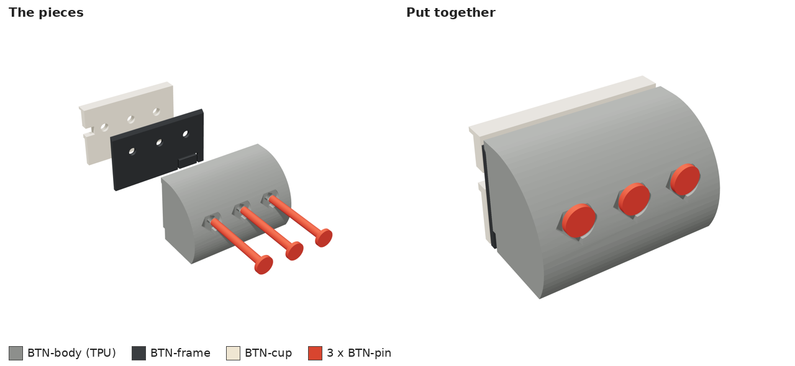

# Remaining tests

**Left to do: A. Reprints: 1 · B. Tests not done yet: 0 · C. Needs the board: 1 · D. Measurements: 4**

Only what is still open. Finished tests are not here (the record of those is COUPON-RESULTS.md). Tick a box or write in a blank. Never press on the screen glass.

## Print settings (use these for every remaining piece)

| Piece | Settings |
|---|---|
| BTN-pin-rib3.05, -rib3.1, -rib3.15 (PETG) | 0.4 mm nozzle. 0.12 mm layers. Line width 0.42 mm for every line type. Wall generator Classic. 3 walls, 100 % infill (they are only 2.6 mm thick). Supports off. They stand on their heads (laid that way in the 3MF). Elephant foot compensation 0.15 mm. |
| Where the settings are | Bambu Studio: Process, tab Quality, 'Line width'; tab Strength, 'Wall generator'. Set both before slicing. Classic keeps every wall exactly 0.42 mm; the other generator (Arachne) squeezes wall widths to fit thin features, which changes how a lip or a pocket comes out. |

## A. Reprints (pieces changed by your last results)

One thing to print: three pins (coupons/buttons-petg.3mf). Glass ring, cap, clip, seat and back-cover tests are finished.

### A4. Button pin: which grip is right (fourth try)

**What you're testing and why:** Last time all three pins (bands 2.8, 2.9, 3.0) fell out when tipped, and the 3.2 band before that was too tight. So the right size is between 3.0 and 3.2. Here are three pins in that gap: 3.05, 3.10 and 3.15 mm, marked by 1, 2 or 3 grooves across the head. Try all three in the TPU strip and tell me which feels right: stays in when tipped, still easy to press and to pull out.

| Piece | Where it is | Note |
|---|---|---|
| **BTN-pin-rib3.05 (1 groove), BTN-pin-rib3.1 (2 grooves), BTN-pin-rib3.15 (3 grooves)** | coupons/buttons-petg.3mf (or the three STLs) | PETG, new. Stand on their heads |
| **BTN-body, BTN-frame, BTN-cup** | already printed | reuse them |

**Print settings:** Pins: 0.12 mm layers, 3 walls, 100 % infill, line width 0.42, Classic walls, supports off, elephant foot compensation 0.15 mm. They stand on their heads.

**What to do:**

1. Stack the strip as before: BTN-cup (flat side towards the body), then BTN-frame, then BTN-body with its curved ridge at the far end. Line up one set of three holes.
2. Push the 1-groove pin in from the ridge end until it is through all three layers. Press it and let go. Tip the strip with the ridge down and shake gently. Pull the pin out with a fingernail.
3. Do the same with the 2-groove pin, then the 3-groove pin (a fresh set of holes for each keeps the tunnels unworn).

| Question | Answer |
|---|---|
| 1-groove pin (3.05 mm band): how does it feel? | ☐ falls out when tipped  ☐ just right: stays in, easy to press, easy to pull  ☐ a little stiff  ☐ too stiff, sticks |
| 2-groove pin (3.10 mm band): how does it feel? | ☐ falls out when tipped  ☐ just right: stays in, easy to press, easy to pull  ☐ a little stiff  ☐ too stiff, sticks |
| 3-groove pin (3.15 mm band): how does it feel? | ☐ falls out when tipped  ☐ just right: stays in, easy to press, easy to pull  ☐ a little stiff  ☐ too stiff, sticks |
| Which one would you choose? | ☐ 1 groove  ☐ 2 grooves  ☐ 3 grooves  ☐ none of them |

## B. Tests not done yet

Nothing left here. The seat test is finished, and the T1/T2/T3 material test was answered long ago (TPU for AMS, T1, no firm zone, 13 mm legs right).

## C. Needs the board (when it arrives)

Needs the pin you choose in A4 and the real board. The plate, ports, labels and most of the button test are done.

### C5. POWER pin, BOOT and RESET on the board

**What you're testing and why:** Only POWER goes to the outside of the case now (your call: RESET can be a programmed short press of POWER, and you have never needed BOOT). BOOT and RESET stay as small paperclip holes in the screen module. This checks the POWER pin (the one you pick in A4) returns when you let go, and that a paperclip reaches BOOT and RESET through the first two holes of BTN-cup (the holes in that piece are bigger than the real ones, which is fine for this check).

| Piece | Where it is | Note |
|---|---|---|
| **BTN-cup, the pin you chose in A4** | from test A4 | reuse them |

**Print settings:** Nothing to print.

**What to do:**

1. Lay the board on the table with the buttons along the top edge, as in the picture. From the USB-C end: 1 = RESET, 2 = BOOT, 3 = POWER.
2. Hold BTN-cup about 3 mm from the buttons with the right-hand hole over POWER. Push the pin through it until it touches the button.
3. Press, let go. Does the board react once per press, and only while you press?
4. Switch the board off, then use the pin to switch it back on.
5. Slide BTN-cup to the left so the other two holes are over BOOT and RESET. Push a straightened paperclip through each and feel for the click.

| Question | Answer |
|---|---|
| Does the pin click POWER? | ☐ yes  ☐ no |
| Does the pin (the one you chose in A4) come back when you let go, so POWER is not held down? | ☐ yes  ☐ no, it stays down |
| Can you switch the board back on through the pin? | ☐ yes, short press  ☐ yes, needs a hard press  ☐ no |
| Does a paperclip click BOOT and RESET through the first two holes? | ☐ both  ☐ only ___  ☐ neither |

## D. Measurements (calipers)

Calipers, in mm, one decimal. D1, D2 and D5 need the battery, D6 the accelerometer.

### D1. Battery thickness

**What you're testing and why:** The most important number. It sets how thick the front wall of the case is.

**What to do:**

1. Lay the battery flat. Close the jaws across the thickest point, including the taped circuit board at the end. Just touching: do not squeeze.

| Question | Answer |
|---|---|
| Thickness (T) | ☐ ___ mm |

### D2. Battery length and width

**What you're testing and why:** Checks the battery fits its bay (106 x 70 mm now).

**What to do:**

1. Measure the outer edges of the pouch, including the folded seam and the circuit-board end.

| Question | Answer |
|---|---|
| Length (L) | ☐ ___ mm |
| Width (W) | ☐ ___ mm |

### D5. Battery wires

**What you're testing and why:** Decides which way round the battery goes and where its wires pass.

**What to do:**

1. Note which edge the wires leave from. Measure from the pouch to the plug.

| Question | Answer |
|---|---|
| Wires leave from | ☐ a short end  ☐ a long side |
| Wire length | ☐ ___ mm |

### D6. Accelerometer board

**What you're testing and why:** So its seat can be made the right size; it has to sit rigid and square.

**What to do:**

1. Measure the little board: length, width, total height including the tallest part and any pins, hole size, and the spacing between hole centres.

| Question | Answer |
|---|---|
| Length x width | ☐ ___ x ___ mm |
| Height | ☐ ___ mm |
| Hole size and spacing | ☐ hole ___ mm  ☐ spacing ___ mm |

---

For Claude: what each answer changes (ignore this)

| Test | Answer | Changes in cad/params.py |
|---|---|---|
| A4 | which pin | `1 groove -> PIN_RIB_D 3.05, 2 -> 3.10, 3 -> 3.15. 'None': all fall out -> try 3.15 to 3.2 and a second band; all stick -> try 3.0 to 3.05, or a different retention (a lip in the dimple). Then retest in C5` |
| A4 | head | `too small -> PIN_HEAD_D (now 8.0); too sunk/proud -> PIN_PROUD (now 1.6); CBORE_D follows (8.6)` |
| C5 | click / return / hard press | `no click -> BTN_TIP_Y or BUTTON_HOLE_D; stuck -> PIN_RIB_D -0.1 (the grip band holds the pin down; 3.2 did); POWER no -> PIN_OVERTRAVEL` |
| D1 | T | `BATT_T (drives FRONT_T)` |
| D2 | L, W | `BATT_L, BATT_W; decides the speaker (decisions.md)` |
| D5 | wires | `battery orientation, WIRE_NOTCH` |
| D6 | accelerometer | `ACC_L, ACC_W, ACC_T, seat on the plate` |

