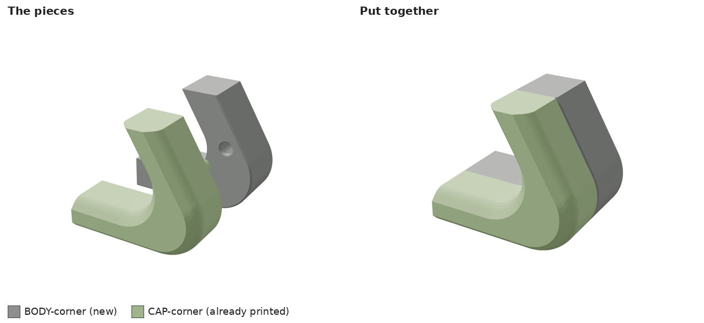
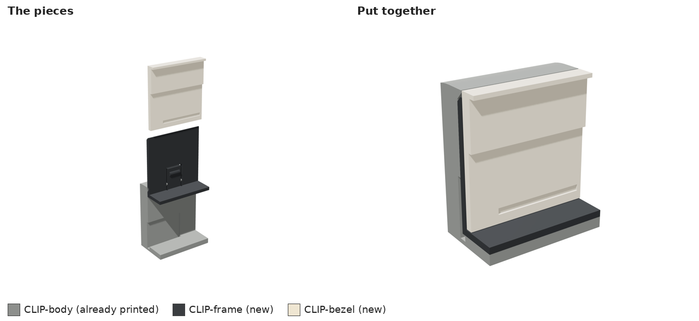
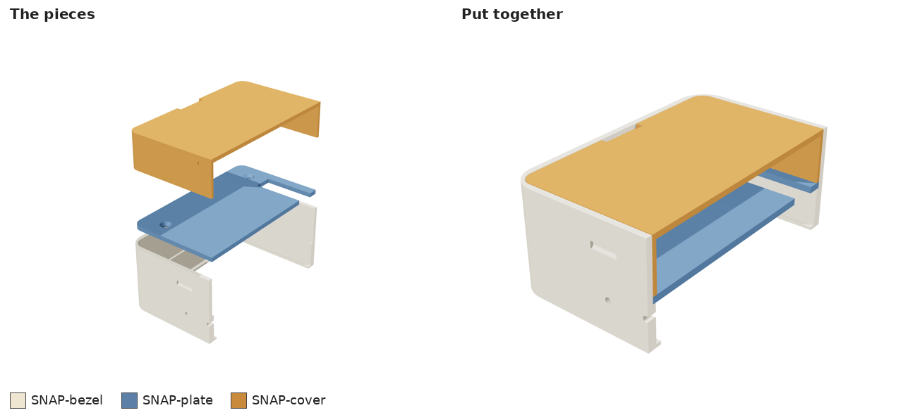
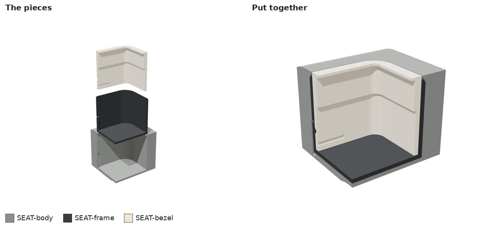
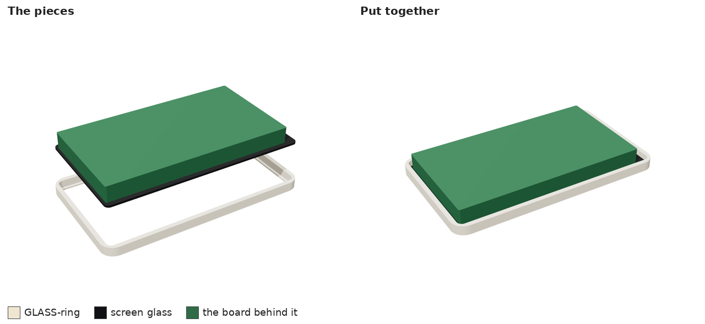

# Remaining tests

**Left to do: A. Reprints: 3 · B. Tests not done yet: 1 · C. Needs the board: 4 · D. Measurements: 8**

Only what is still open. Finished tests are not here (the record of those is COUPON-RESULTS.md). Tick a box or write in a blank. Never press on the screen glass.

## A. Reprints (pieces changed by your last results)

Two files to print: coupons/reprint-tpu.3mf (one TPU piece) and coupons/reprint-petg.3mf (five PETG pieces).

### A1. Cap push-fit, third try

**What you're testing and why:** The end cap pushes onto the body with pegs, no glue. Last time it was loose and wobbled, so the holes are now a little smaller. This checks the cap is snug, sits flat and still comes off by hand.

| Piece | Where it is | Note |
|---|---|---|
| **BODY-corner** | coupons/reprint-tpu.3mf (or BODY-corner.stl) | print this one |
| **CAP-corner** | already printed | reuse it, it has not changed |

**Print settings:** TPU for AMS, 2 walls, 10 % gyroid, 0.2 mm layers, supports off. It prints with the two holes facing up.

**What to do:**

1. Push the two pegs of CAP-corner into the two holes of the new BODY-corner until the faces meet.
2. Look at the gap all the way round, then try to rock and slide the cap sideways.
3. Pull it off and push it back on ten times.

| Question | Answer |
|---|---|
| How is the push-fit? | ☐ falls off  ☐ loose  ☐ right: snug, comes off by hand  ☐ too tight  ☐ won't go in |
| Do the faces close up all the way round? | ☐ yes  ☐ even gap of ___ mm  ☐ uneven gap, ___ to ___ mm |
| Does the cap wobble or shift sideways once on? | ☐ no  ☐ a little  ☐ yes |
| Does the small groove at the join still look intended? | ☐ yes  ☐ too faint  ☐ too heavy |
| Do the outside faces line up across the join? | ☐ flush  ☐ step of ___ mm |
| The round pocket with a pointed top on the outside of BODY-corner (for a foot pad): printed clean? | ☐ yes  ☐ no |

### A2. Clip click, second try

**What you're testing and why:** Four spring clips hold the screen module in the case. Last time the click was weak, close to none, so the bump on the clip is now bigger. This checks it clicks and holds without the clip breaking.

| Piece | Where it is | Note |
|---|---|---|
| **CLIP-frame** | coupons/reprint-petg.3mf (or CLIP-frame.stl) | print this one |
| **CLIP-bezel** | coupons/reprint-petg.3mf (or CLIP-bezel.stl) | print this one |
| **CLIP-body** | already printed | reuse it |

**Print settings:** PETG, 4 walls, 15 % infill, 0.2 mm layers, supports off. CLIP-bezel prints face down.

**What to do:**

1. Push CLIP-frame into CLIP-body.
2. Slide CLIP-bezel in from the front until it clicks.
3. Pull it out and push it in ten times, then look at the little spring finger on the frame.

| Question | Answer |
|---|---|
| Click and hold? | ☐ no click  ☐ weak  ☐ right  ☐ too stiff |
| The spring finger after ten pulls? | ☐ fine  ☐ turned white  ☐ snapped |
| Did the finger print free (slots around it open)? | ☐ yes  ☐ fused |

### A3. Back cover snap and carrier plate

**What you're testing and why:** My mistake last time: the corner piece I gave you did not include the cover's snap ridge, so it could never hold. The cover grips between the two long walls, so this test is the whole end of the screen module, full width. It also re-checks the plate, which was loose and is now a touch larger.

| Piece | Where it is | Note |
|---|---|---|
| **SNAP-bezel** | coupons/reprint-petg.3mf (or SNAP-bezel.stl) | new |
| **SNAP-plate** | coupons/reprint-petg.3mf (or SNAP-plate.stl) | new; keep it for test C3 |
| **SNAP-cover** | coupons/reprint-petg.3mf (or SNAP-cover.stl) | new |

**Print settings:** PETG, 4 walls, 15 % infill, 0.2 mm layers, supports off. SNAP-bezel prints face down.

**What to do:**

1. Lay SNAP-bezel face down on the table.
2. Drop SNAP-plate in. It should sit on the small step inside the walls.
3. Press SNAP-cover in behind it until it snaps.
4. Turn it over and shake it. Then open the cover with a fingernail in the notch at its end.

| Question | Answer |
|---|---|
| The plate on its step? | ☐ loose, slides about  ☐ right  ☐ tight  ☐ won't go in |
| The cover snap? | ☐ falls out  ☐ holds but weak  ☐ right  ☐ too hard to open |
| Is the cover's back level with the bezel's back edge? | ☐ level  ☐ sticks out ___ mm  ☐ sunk ___ mm |
| Can you open it with a fingernail at the notch? | ☐ yes  ☐ no, needs a tool |

## B. Tests not done yet

The T1/T2/T3 material test is not here: I have your answers (TPU for AMS, T1, no firm zone, 13 mm legs right).

### B1. Seat: body, frame and bezel corner

**What you're testing and why:** This is one corner of the real case: the soft body, the stiff frame inside it, and the cream bezel. It checks how the three fit and how the thin line between cream and body looks. Your results document had ticks for this test, but your message says you have not done it, so it is here to be sure. If the ticks were real, tick "same as my results document" and skip the rest.

| Piece | Where it is | Note |
|---|---|---|
| **SEAT-body** | already printed (coupons/coupons-fit-body.3mf) | TPU |
| **SEAT-frame** | coupons/SEAT-frame.stl | PETG; print it if you have not |
| **SEAT-bezel** | coupons/SEAT-bezel.stl | PETG, face down; print it if you have not |

**Print settings:** PETG, 4 walls, 15 % infill, 0.2 mm layers, supports off for the frame and bezel.

**What to do:**

1. Push SEAT-frame into SEAT-body, under the sloped lip.
2. Push SEAT-bezel into the frame until its face is level with the body.
3. Look at the line between cream and body, and press on the body wall beside the frame.

| Question | Answer |
|---|---|
| Already done? | ☐ same as my results document, skip the rest  ☐ no, answers below |
| Frame into body? | ☐ loose  ☐ right  ☐ too hard  ☐ won't go under the lip |
| Does the soft body wall bulge or flex where the frame sits? | ☐ no  ☐ a little  ☐ yes |
| Bezel into frame? | ☐ loose  ☐ right  ☐ tight |
| The line between cream and body? | ☐ good, even  ☐ too wide  ☐ too tight, rubbing |
| Bezel face level with the body face? | ☐ level  ☐ sticks out ___ mm  ☐ sunk ___ mm |

## C. Needs the board (when it arrives)

C1 to C3 use printed pieces on the real board. C4 is reading labels.

### C1. Glass ring on the real screen

**What you're testing and why:** The ring is the front 6 mm of the cream bezel. It checks the real glass drops in, that the bezel's lip hides only the black border and not the picture, and that nothing presses on the glass.

| Piece | Where it is | Note |
|---|---|---|
| **GLASS-ring** | coupons/GLASS-ring.stl | print it if you have not |

**Print settings:** PETG (cream if you have it), 4 walls, 15 % infill, 0.12 mm layers, supports off. Prints face down.

**What to do:**

1. Lay GLASS-ring face down on a soft cloth.
2. Lower the screen into it, glass down. Never press on the glass.
3. Turn it over, holding both, and look at the screen through the opening with the screen switched on if you can.

| Question | Answer |
|---|---|
| Does the glass drop in? | ☐ falls in and rattles  ☐ just right  ☐ tight  ☐ won't go |
| Does the lip cover only the black border, not the picture? | ☐ yes  ☐ covers the picture on the ___ side |
| Does the black border look even enough behind the cream? | ☐ yes  ☐ no |
| With the board resting in the ring, is there a gap between lip and glass? | ☐ touching  ☐ small gap  ☐ large gap |

### C2. Port block on the real ports

**What you're testing and why:** Your cable fits the +1 tunnel, and that is now the size of the real openings. What is left is to check on the real board that both tunnels meet both USB-C ports at once, and that the plug goes fully home.

| Piece | Where it is | Note |
|---|---|---|
| **PORT-block** | already printed | reuse it |

**Print settings:** Nothing to print.

**What to do:**

1. Hold PORT-block against the end of the board where the two USB-C ports are, tunnels over the ports.
2. Push your cable through the +1 tunnel into each port in turn.

| Question | Answer |
|---|---|
| Do both tunnels line up with both ports at once? | ☐ yes  ☐ off by ___ mm |
| Does the plug go fully home through the +1 tunnel? | ☐ yes, both ports  ☐ no |

### C3. Carrier plate on the board

**What you're testing and why:** The board screws to the carrier plate through its brass standoffs. This checks the holes and the cut-out in the plate are where the real board needs them.

| Piece | Where it is | Note |
|---|---|---|
| **SNAP-plate** | from test A3 | reuse it |

**Print settings:** Nothing to print.

**What to do:**

1. Lay the board glass down on a soft cloth.
2. Lay SNAP-plate on the brass standoffs at the end away from the USB-C ports, countersunk side up.
3. Look down the two screw holes, and at the long pin header poking through the cut-out.

| Question | Answer |
|---|---|
| Do the two screw holes sit over the two standoffs? | ☐ yes  ☐ off by ___ mm |
| Does the plate sit flat on the standoffs? | ☐ yes  ☐ no, held up by ___ |
| Does the pin header clear the cut-out? | ☐ yes  ☐ touches |

### C4. Read the board's printed labels

**What you're testing and why:** A few things are not in Waveshare's drawing. The picture shows the back of the board with numbers; please read the tiny white labels next to each.

**Print settings:** Nothing to print.

**What to do:**

1. Hold the board as in the picture: back towards you, USB-C ports on the left, buttons along the top.

| Question | Answer |
|---|---|
| Buttons 1, 2, 3 (left to right): which is which? | ☐ 1 = ___  ☐ 2 = ___  ☐ 3 = ___ |
| Which USB-C port is labelled UART? | ☐ A (upper)  ☐ B (lower) |
| Sockets X, Y, Z: which is BAT (battery) and which is SPK (speaker)? | ☐ BAT = ___  ☐ SPK = ___ |
| Mics M1 and M2: is there a small hole on top of the metal can? | ☐ yes  ☐ no, plain top |

## D. Measurements (calipers)

Calipers, in mm, one decimal. D1 to D2 and D5 need the battery, D3, D4 and D7 the board, D6 the accelerometer.

### D1. Battery thickness

**What you're testing and why:** The most important number. It sets how thick the front wall of the case is.

**What to do:**

1. Lay the battery flat. Close the jaws across the thickest point, including the taped circuit board at the end. Just touching: do not squeeze.

| Question | Answer |
|---|---|
| Thickness (T) | ☐ ___ mm |

### D2. Battery length and width

**What you're testing and why:** Checks the battery fits its bay (106 x 70 mm now).

**What to do:**

1. Measure the outer edges of the pouch, including the folded seam and the circuit-board end.

| Question | Answer |
|---|---|
| Length (L) | ☐ ___ mm |
| Width (W) | ☐ ___ mm |

### D3. Screen depth to the pin header

**What you're testing and why:** Waveshare's two files disagree (12.8 and 11.6 mm).

**What to do:**

1. Lay the board glass down on a soft cloth. Use the depth rod from the table (the glass front) to the top of the long pin header.

| Question | Answer |
|---|---|
| Depth (H) | ☐ ___ mm |

### D4. Screen depth to a brass standoff

**What you're testing and why:** Sets the small gap that keeps the bezel's lip off the glass. Should be 11.6 mm.

**What to do:**

1. Same set-up. Depth rod from the table to the top of one of the four brass standoffs.

| Question | Answer |
|---|---|
| Depth (S) | ☐ ___ mm |

### D5. Battery wires

**What you're testing and why:** Decides which way round the battery goes and where its wires pass.

**What to do:**

1. Note which edge the wires leave from. Measure from the pouch to the plug.

| Question | Answer |
|---|---|
| Wires leave from | ☐ a short end  ☐ a long side |
| Wire length | ☐ ___ mm |

### D6. Accelerometer board

**What you're testing and why:** So its seat can be made the right size; it has to sit rigid and square.

**What to do:**

1. Measure the little board: length, width, total height including the tallest part and any pins, hole size, and the spacing between hole centres.

| Question | Answer |
|---|---|
| Length x width | ☐ ___ x ___ mm |
| Height | ☐ ___ mm |
| Hole size and spacing | ☐ hole ___ mm  ☐ spacing ___ mm |

### D7. Glass outline

**What you're testing and why:** Checks Waveshare's drawing (126.9 x 70.7 mm).

**What to do:**

1. Across the glass: long side, then short side.

| Question | Answer |
|---|---|
| Long side | ☐ ___ mm |
| Short side | ☐ ___ mm |

### D8. Speaker, only if you want one fitted

**What you're testing and why:** No room is reserved for a speaker yet. If you want alarms and chimes from the case, I need its size to find it a home.

**What to do:**

1. Measure across the speaker and its total depth.

| Question | Answer |
|---|---|
| Fit a speaker? | ☐ yes  ☐ no |
| Diameter and depth | ☐ ___ mm across  ☐ ___ mm deep |

---

For Claude: what each answer changes (ignore this)

| Test | Answer | Changes in cad/params.py |
|---|---|---|
| A1 | push-fit | `loose -> PEG_FIT -0.05; too tight -> +0.05; won't go -> +0.10` |
| A1 | faces close | `even gap -> PEG_L -0.5; uneven -> PEG_SLOT +0.1` |
| A1 | wobble | `yes -> PEG_SLOT -0.1; a little -> leave` |
| A1 | groove / flush | `GROOVE; step -> more or thicker pegs (peg_spots)` |
| A1 | pad pocket | `no -> teardrop in pads_and_recesses()` |
| A2 | click | `none/weak -> CLIP_BUMP +0.10; too stiff -> CLIP_BUMP -0.10 or CLIP_LEN +3` |
| A2 | finger | `white/snapped -> CLIP_LEN +4, CLIP_BUMP -0.10; second failure -> magnets (brief: one iteration)` |
| A2 | printed free | `fused -> CLIP_SLOT +0.2` |
| A3 | plate | `loose -> PLATE_CLEAR -0.05; tight -> +0.05` |
| A3 | cover snap | `falls out/weak -> SNAP_BUMP +0.10; too hard -> -0.10; sloppy -> COVER_CLEAR -0.05` |
| A3 | cover level | `COVER_FLOOR / MOD_D` |
| A3 | fingernail | `no -> larger notch in parts.cover()` |
| B1 | frame into body | `loose -> FRAME_FIT -0.10; too hard -> +0.10` |
| B1 | wall flex | `yes -> FIRM_ZONE = 'T2' (modifier-firm-zone.stl); a little -> leave` |
| B1 | bezel into frame | `loose -> FRAME_CLEAR -0.05 (changes pocket size: reissue SEAT-body); tight -> +0.10` |
| B1 | line / level | `SEAM (0.30); FRAME_FLOOR / POCKET_D` |
| C1 | glass | `rattles -> GLASS_CLEAR -0.10; tight -> +0.10; won't go -> +0.20` |
| C1 | lip / border / gap | `LIP_OVERLAP; BEZEL_WALL; LIP_GAP with D4` |
| C2 | line-up / home | `USB_Y; USB_WINDOW, USB_WINDOW_R` |
| C3 | holes / flat / header | `STANDOFFS, SCREW_D; STANDOFF_H; HEADER_BOX, J5_BOX` |
| C4 | labels | `button access notes; cable guidance; WIRE_NOTCH; mic path (MIC_EXIT_Y, listening test)` |
| D1 | T | `BATT_T (drives FRONT_T)` |
| D2 | L, W | `BATT_L, BATT_W` |
| D3 | H | `MODULE_DEPTH` |
| D4 | S | `GLASS_TO_BOARD + STANDOFF_H (= 11.6), LIP_GAP` |
| D5 | wires | `battery orientation, WIRE_NOTCH` |
| D6 | accelerometer | `ACC_L, ACC_W, ACC_T, seat on the plate` |
| D7 | glass | `GLASS_L, GLASS_W` |
| D8 | speaker | `decisions.md 8.7; new geometry` |

